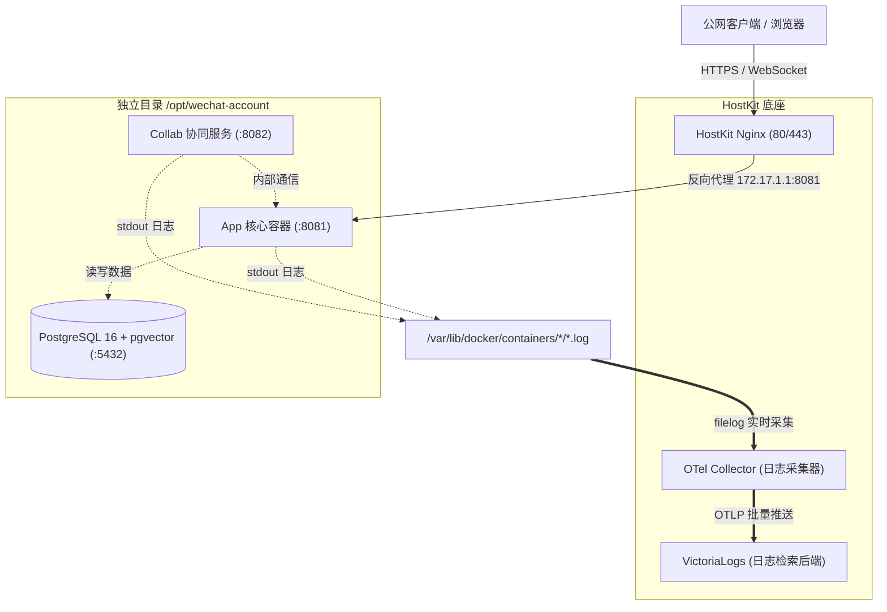

# 业务应用部署与接入指南

本文档介绍如何在已安装 HostKit 的服务器上部署独立的业务应用（Docker Compose 架构），并通过 HostKit 完成 **HTTPS 自动证书配置**、**WebSocket/SSE 反向代理** 与 **VictoriaLogs 日志统一采集**。

本文以 **`wechat-account`（微信公众平台与 AI 创作服务）** 为完整落地范例。

---

## 一、 整体架构与网络模型

HostKit 作为单机基础设施管理底座，推荐业务应用与基础设施保持**独立部署、统一网关、统一观测**：



### 网络反代接入的两种方式

| 方式 | 配置示例 | 适用场景 | 说明 |
|---|---|---|---|
| **宿主网关反代（推荐）** | `crm.example.com 172.17.1.1:8081` | 业务 Compose 自带独立网络并映射宿主端口 | 业务完全独立，不与底层网络产生耦合；网关 IP 通过 `docker network inspect base-net` 查询 |
| **共享网络反代** | `crm.example.com myapp:8080` | 业务直接加入 `base-net` 外部网络 | 业务 Compose 声明 `networks: default: external: true, name: base-net` |

---

## 二、 完整部署落地实战（以 wechat-account 为例）

### 1. 部署目录与配置准备

在服务器上创建独立的部署目录（例如 `/opt/wechat-account`），包含编排文件、挂载配置及环境变量：

```bash
# 目录结构规划
/opt/wechat-account/
├── docker/
│   └── docker-compose.yml     # Compose 编排文件
├── api/
│   └── configs/               # 应用配置只读挂载
├── scripts/
│   ├── cordis-cutover-preflight.sh
│   └── migrate-app-data-volume.sh
└── .env                       # 业务独立密钥与镜像配置（chmod 600）
```

### 2. 配置 `.env` 环境变量

在 `/opt/wechat-account/.env` 中配置数据库密钥与镜像标签：

```dotenv
POSTGRES_USER=wechat
POSTGRES_PASSWORD=your_strong_password
POSTGRES_DB=wechat_articles
DB_PORT=5432

JWT_SECRET=your_jwt_secret_32bytes
COLLAB_SERVICE_TOKEN=your_collab_token_32bytes
WECHAT_MASTER_KEY=your_encryption_master_key_32bytes

# 镜像引用（使用预构建的云仓库镜像，无需在服务器现场构建）
APP_IMAGE=ccr.ccs.tencentyun.com/your-org/wechat-account-app:v0.1.4
COLLAB_IMAGE=ccr.ccs.tencentyun.com/your-org/wechat-account-collab:v0.1.4
```

### 3. 拉取依赖镜像并启动服务

```bash
cd /opt/wechat-account

# 1. 预拉取带向量扩展的基础数据库镜像
docker pull pgvector/pgvector:pg16

# 2. 启动数据库并等待健康探测通过
docker compose -p wechat-account -f docker/docker-compose.yml --env-file .env up -d --wait db

# 3. 执行数据迁移与切换预检
sh ./scripts/cordis-cutover-preflight.sh docker/docker-compose.yml .env wechat-account
sh ./scripts/migrate-app-data-volume.sh docker/docker-compose.yml .env wechat-account

# 4. 启动应用服务（首次启动自动执行数据库 migration 初始化）
docker compose -p wechat-account -f docker/docker-compose.yml --env-file .env up -d --no-build app collab

# 5. 检查容器状态（确认均为 Up healthy）
docker compose -p wechat-account -f docker/docker-compose.yml --env-file .env ps
```

---

## 三、 HostKit 域名反代与 HTTPS 证书签发

业务应用启动并监听端口（如 `8081`）后，通过 HostKit 统一接管域名访问。

### 1. 配置域名与反代目标

在 `~/hostkit/config.env` 中的 `SITES` 列表中追加业务域名和反代目标：

```dotenv
SITES="
crm.costalong.cn     172.17.1.1:8081
vlog.costalong.cn    victorialogs
"
```
> **提示**：先在 DNS 解析服务商处，将 `crm.costalong.cn` 的 A 记录指向服务器的公网 IP。

### 2. 热重载生效

在 `~/hostkit` 目录下执行：

```bash
make nginx
```
> HostKit 会自动完成：
> 1. 生成 `/opt/base/nginx/conf.d/site-crm.costalong.cn.conf`；
> 2. 检查并为新域名向 Let's Encrypt 申请正式 SSL 证书；
> 3. 配置 HTTP 80 强制跳转 HTTPS 443；
> 4. 自动注入 WebSocket（`Upgrade` / `Connection`）与长连接流式响应（SSE）代理配置；
> 5. 校验语法并平滑热重载 Nginx（无缝切换，零停机）。

### 3. 验证访问

```bash
make status
curl -sI https://crm.costalong.cn/
curl -s https://crm.costalong.cn/readyz
```

---

## 四、 开启 VictoriaLogs 日志收集

业务容器无需集成专门的 SDK，HostKit 采用无侵入式的日志收集方案。

### 1. 启用 OTel Collector

在 `~/hostkit` 目录下执行：

```bash
make otel
```

HostKit 的 OTel Collector 会自动读取 `/var/lib/docker/containers/*/*-json.log`，将本机所有运行中容器的标准输出与错误日志实时结构化转存至 VictoriaLogs。

### 2. 检索日志

打开 **`https://vlog.costalong.cn/`**（输入 Basic Auth 账号密码，密码见 `/opt/base/credentials.env`）：
- 输入 `wechat-api` 即可检索所有核心 API 请求日志；
- 输入 `error` 或 `status_code: >= 400` 即可实时排查接口异常。

---

## 五、 业务服务日常运维与一键更新

为了避免日常发布重复输入多步维护命令，在业务部署目录中提供自动化更新脚本 `/opt/wechat-account/scripts/update.sh`：

```bash
#!/bin/sh
# 在部署服务器上运行：安全拉取/替换应用容器并校验就绪状态
# 用法：sh scripts/update.sh [新tag，例如 v0.1.5 或留空使用当前.env配置]
set -eu

DEPLOY_DIR="/opt/wechat-account"
cd "$DEPLOY_DIR"

COMPOSE_FILE="docker/docker-compose.yml"
ENV_FILE=".env"
PROJECT="${COMPOSE_PROJECT_NAME:-wechat-account}"

if [ ! -f "$ENV_FILE" ]; then
    echo "缺少 $ENV_FILE，无法执行更新" >&2
    exit 1
fi

TAG="${1:-}"
if [ -n "$TAG" ]; then
    echo ">> 更新 .env 镜像标签为: $TAG"
    sed -i "s|^\(APP_IMAGE=.*:\).*|\1${TAG}|" "$ENV_FILE"
    sed -i "s|^\(COLLAB_IMAGE=.*:\).*|\1${TAG}|" "$ENV_FILE"
fi

compose() { docker compose -p "$PROJECT" -f "$COMPOSE_FILE" --env-file "$ENV_FILE" "$@"; }

echo ">> 确保数据库健康运行..."
compose up -d --wait db

echo ">> 执行切换与数据卷迁移预检..."
sh ./scripts/cordis-cutover-preflight.sh "$COMPOSE_FILE" "$ENV_FILE" "$PROJECT"
sh ./scripts/migrate-app-data-volume.sh "$COMPOSE_FILE" "$ENV_FILE" "$PROJECT"

echo ">> 重新拉起应用服务 (app / collab)..."
compose up -d --no-build --force-recreate --wait --wait-timeout 300 app collab

echo ">> 执行就绪探测..."
curl -fsS http://localhost:8081/healthz >/dev/null && echo "  - API healthz: OK"
curl -fsS http://localhost:8081/readyz >/dev/null && echo "  - API readyz: OK"
curl -fsS http://localhost:8082/readyz >/dev/null && echo "  - Collab readyz: OK"

echo ">> 更新完成，容器状态："
compose ps
```

日常发版仅需一条命令即可完成热替换与健康验证：
```bash
ssh ubuntu@<服务器IP> "cd /opt/wechat-account && sh scripts/update.sh [新标签]"
```
